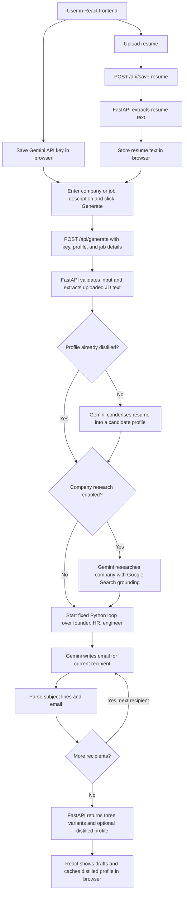

# Postscript

React and Tailwind make the frontend. FastAPI handles the API and calls Gemini. The frontend and backend run separately.

## How it works

This app does not use LangChain or LangGraph. There is no autonomous agent that plans, calls tools, and revises its work. `app.py` controls the workflow with ordinary Python code; `generate.py` and `research.py` call Gemini directly through the `google-genai` SDK. When company research is enabled, Gemini can use its Google Search grounding tool during that one research call.



The loop generates exactly three variants, one each for a founder, recruiter/HR, and engineer. It is a fixed `for` loop, not an agent reasoning or retry loop. Generating again requires another click. Resume extraction does not call Gemini; profile distillation happens on the first generation and is then cached in the browser.

## Run locally

Install Python 3.10+ and Node.js 20.19+ or 22.12+, then from the project root:

```sh
python3 -m venv .venv
source .venv/bin/activate
python -m pip install -r requirements.txt
npm install --prefix frontend
```

Start the backend in one terminal:

```sh
source .venv/bin/activate
python -m uvicorn app:app --reload --host 127.0.0.1 --port 8000
```

Start the frontend in another terminal:

```sh
npm run dev --prefix frontend
```

Open **http://127.0.0.1:5173** for the app. Vite proxies local `/api` calls to FastAPI at port 8000. The backend has API docs at **http://127.0.0.1:8000/docs** and a health check at **http://127.0.0.1:8000/health**. Its root URL does not serve the React page.

Save your Gemini API key and resume in the frontend's Personal setup section. Both are stored in that browser. The key is sent to the FastAPI backend with each generation request; the backend sends it to Gemini. A company name or job description is enough to generate drafts. You can paste a JD or upload a PDF, DOCX, TXT, or MD file up to 5 MB.

The browser key does not come from `.env`. The optional `.env` file can set `GEMINI_MODEL` or `RESEARCH_MODEL`; see `.env.example`.

## Deploy on Render

[`render.yaml`](render.yaml) defines two services from this repository:

| Service | Purpose |
| --- | --- |
| `cold-email-frontend` | Builds `frontend/` and publishes the React site as static files. |
| `cold-email-studio` | Runs FastAPI with Uvicorn and exposes `/api/generate`, `/api/save-resume`, `/health`, and `/docs`. |

Push the project to a Git repository, then create a **New Blueprint** in Render using that repository. The Blueprint passes the backend URL to Vite as `VITE_API_BASE_URL` and the frontend URL to FastAPI as `FRONTEND_ORIGIN` for CORS. After deployment, open the **frontend** URL and enter your Gemini key and resume there. Browser storage from localhost is separate from storage on the deployed site.

If you host the frontend somewhere else, set `VITE_API_BASE_URL` to the public FastAPI URL **before building** the frontend, and set `FRONTEND_ORIGIN` to the frontend's exact origin on the backend. Neither URL needs a trailing slash.

## Project files

- `frontend/`: React, Tailwind, and Vite source
- `app.py`: FastAPI endpoints and request handling
- `generate.py`, `research.py`, `style_examples.md`: Gemini email writing and optional company research
- `config.py`: optional local `.env` loading
- `test_app.py`: API and generator tests

`profile.md` and `emails/` are personal local data and are ignored by Git. The web app uses the resume saved in the browser.
