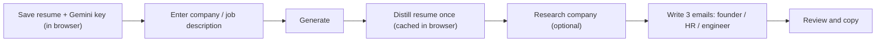

# Postscript

Turn a company name or job description into three short, personal cold emails, one each for a founder, a recruiter/HR, and an engineer. React frontend, FastAPI backend, Google Gemini for the writing.

## How it works



The key and resume are stored in your browser and sent to the backend with each request. The resume is distilled into a short profile on the first generation and cached, so later generations skip that step. Each generation is one fixed pass that produces the three variants; generating again is another click.

## Run locally

Needs Python 3.10+ and Node 20.19+ (or 22.12+). From the project root:

```sh
python3 -m venv .venv
source .venv/bin/activate
python -m pip install -r requirements.txt
npm install --prefix frontend
```

Run the backend and frontend in two terminals:

```sh
# terminal 1 — API on :8000
source .venv/bin/activate
python -m uvicorn app:app --reload --port 8000

# terminal 2 — app on :5173
npm run dev --prefix frontend
```

Open **http://127.0.0.1:5173**. Vite proxies `/api` calls to the backend. Save your Gemini key and resume in the Personal setup section, add a company name or job description (paste it or upload a PDF, DOCX, TXT, or MD up to 3 MB), and generate.

An optional `.env` can set `GEMINI_MODEL` or `RESEARCH_MODEL` (see `.env.example`). The API key is entered in the app, never read from `.env`.

## Deploy on Vercel

The whole repo deploys as one Vercel project. Vercel detects the FastAPI `app` in `app.py` and runs it as a single serverless function (`api/index.py`) that serves both the built React app and the API on the same domain.

Two things matter because of how Vercel bundles the function:

- **The built frontend is committed.** The function is bundled from the Git source, so `public/` (the Vite build) is checked in rather than ignored. After any frontend change, rebuild and commit it:

  ```sh
  npm run build --prefix frontend -- --outDir ../public --emptyOutDir
  git add public && git commit -m "rebuild frontend" && git push
  ```

- **No `/api` rewrite.** FastAPI receives requests on their original paths, so `vercel.json` has no rewrites. It only sets the build command and the function's `maxDuration`.

Leave `VITE_API_BASE_URL` and `FRONTEND_ORIGIN` unset for a same-domain deploy. You may set `GEMINI_MODEL` / `RESEARCH_MODEL` in Vercel; the Gemini key is entered in the app, not as an environment variable. The 3 MB upload limit keeps base64 payloads under Vercel's 4.5 MB function request limit.

## Deploy on Render (alternative)

`render.yaml` defines two services instead: a static site built from `frontend/`, and the FastAPI backend. The blueprint wires the backend URL into the frontend as `VITE_API_BASE_URL` and the frontend origin into the backend as `FRONTEND_ORIGIN` (CORS). Create a new Blueprint from the repo, then open the frontend URL.

## Project files

- `frontend/` — React, Tailwind, Vite source
- `public/` — built frontend (committed for Vercel)
- `app.py` — FastAPI endpoints, request handling, static serving
- `generate.py`, `research.py`, `style_examples.md` — Gemini writing and optional company research
- `api/index.py` — Vercel entry point that exposes the FastAPI app
- `config.py` — optional local `.env` loading
- `test_app.py` — tests

`profile.md` and `emails/` are personal local data and are Git-ignored; the web app uses the resume saved in the browser.
