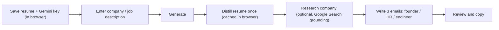

# Postscript

Turn a company name or job description into three short, personal cold emails, one each for a founder, a recruiter/HR, and an engineer. A React single-page app that calls Google Gemini **directly from your browser** with your own API key.

## Privacy

There is no application server in the data path. Your Gemini API key and your resume are stored only in your browser (localStorage) and are sent straight to Google's Gemini API when you generate. They never reach any server of ours. The resume file is parsed to text in the browser too, so the file itself never leaves your device. The only backend is a static file host that serves the built app and has no endpoint that accepts data.

## How it works



The resume is distilled into a short profile on the first generation and cached, so later generations skip that step. Each generation is one fixed pass that produces the three variants; generating again is another click. The model is chosen with a dropdown (default Gemini 3.5 Flash-Lite).

## Run locally

Needs Node 20.19+ (or 22.12+):

```sh
npm install --prefix frontend
npm run dev --prefix frontend
```

Open **http://127.0.0.1:5173**. Save your Gemini key and resume in the Personal setup section, add a company name or job description (paste it or upload a PDF, DOCX, TXT, or MD up to 3 MB), and generate. No backend is needed to develop; the browser talks to Gemini directly.

## Deploy on Vercel

The repo deploys as one Vercel project. `vercel.json` builds the React app into `public/`, and a small FastAPI function (`api/index.py` / `app.py`) serves those static files. That function only serves files; it has no data endpoints.

Because Vercel bundles the function from the Git source, the built `public/` is committed. After any frontend change, rebuild and commit it:

```sh
npm run build --prefix frontend -- --outDir ../public --emptyOutDir
git add public && git commit -m "rebuild frontend" && git push
```

No environment variables are needed; the model and key are chosen in the app. Any plain static host also works if you prefer (serve the `public/` build).

## Project files

- `frontend/src/App.jsx` — the UI
- `frontend/src/gemini.js` — direct in-browser Gemini calls
- `frontend/src/extract.js` — in-browser PDF/DOCX/TXT/MD text extraction
- `frontend/src/prompts.js` — prompt text, style examples, and output parsing
- `frontend/src/index.css` — styles
- `public/` — built frontend (committed for Vercel)
- `app.py`, `api/index.py` — static file host for deployment

`profile.md` and `emails/` are personal local notes and are Git-ignored.
